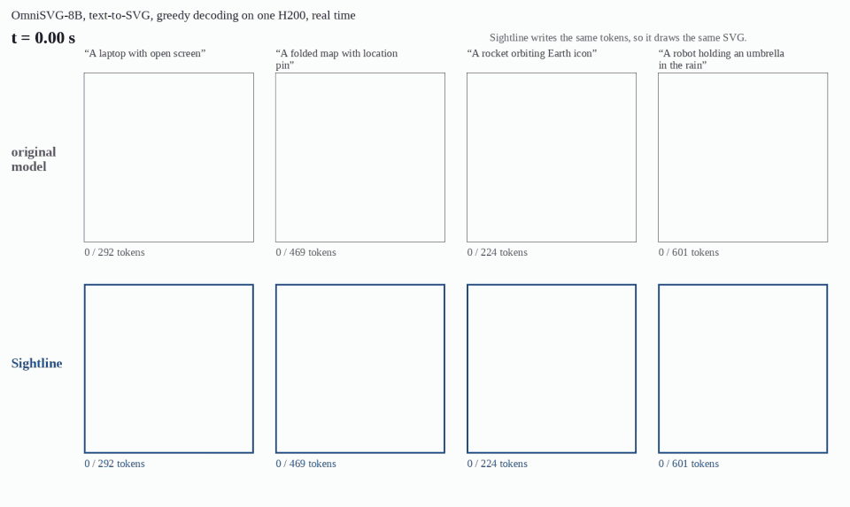
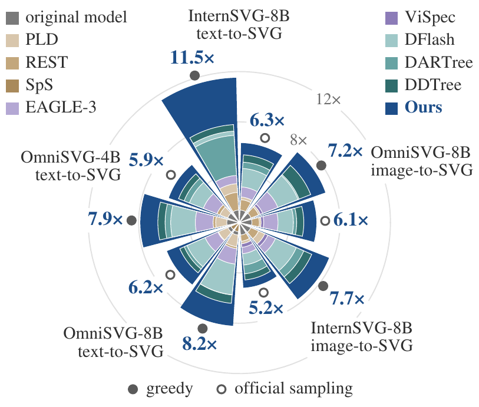
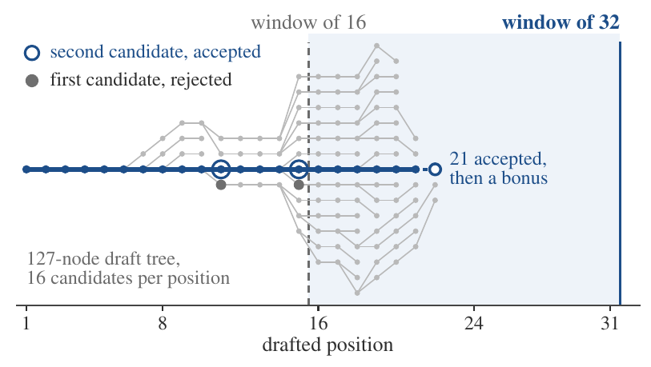

<div align="center">

# Sightline: Long-Window Speculative Decoding for Fast SVG Generation

Yanchao Li<sup>1,2</sup>, Ben Gao<sup>3</sup>, Jiaqing Xie<sup>4,2</sup>, Yusu Zhang<sup>5</sup>, Beilun Wang<sup>6</sup>,
Yanbo Wang<sup>7</sup>, Xiaohua Xu<sup>8</sup>, Nanqing Dong<sup>2,9</sup>, Tianfan Fu<sup>1,2*</sup>, Zhongyu Huang<sup>2*</sup>

<sup>1</sup>Nanjing University &nbsp; <sup>2</sup>Shanghai Artificial Intelligence Laboratory &nbsp; <sup>3</sup>Wuhan University
&nbsp; <sup>4</sup>Fudan University &nbsp; <sup>5</sup>Shanghai Jiao Tong University &nbsp; <sup>6</sup>Southeast University
&nbsp; <sup>7</sup>North University of China &nbsp; <sup>8</sup>University of Science and Technology of China
&nbsp; <sup>9</sup>Shanghai Innovation Institute

<sup>*</sup>Corresponding authors

Paper: [arXiv](https://arxiv.org/abs/2611.23807) &nbsp;·&nbsp; [Video](assets/sightline_decoding.mp4) &nbsp;·&nbsp; [Citation](#citation)

</div>

<p align="center">
  
</p>

<p align="center"><em>OmniSVG-8B, text-to-SVG, greedy decoding on one H200, in real time. Sightline writes the same tokens
as the original model, so it draws the same SVG, and it finishes all four prompts within 0.93 s.</em></p>

## Overview

Scalable Vector Graphics (SVG) generation models write a graphic as code with one forward pass per token, so
drawing is slow. Speculative decoding speeds them up losslessly, and block drafters guess many tokens per pass. On
SVG, many of their rounds accept the whole draft and end only at the verification window: the drafters' misses are
rare and clumped, and they stay accurate far deeper into a block than on natural language. A run-length identity
and three propositions show that a longer window pays once the candidates are wide, up to the drafter's horizon.

**Sightline** pairs a window as long as the drafter's horizon with a draft tree wide enough to fill it. It drafts
with a head trained for twice the window of existing block drafters, and verifies a draft tree with enough
candidates to fill the whole window.

<p align="center">
  
  &nbsp;
  
</p>

<p align="center"><em>Left: speedups of nine lossless decoders over the original model (Figure 1 of the paper).
Right: one round of Sightline, where the accepted path runs past the window of 16 (Figure 2).</em></p>

- On OmniSVG-8B, OmniSVG-4B and InternSVG-8B, Sightline is faster than every compared lossless decoder in every
  setting, and **4.25× to 13.83×** faster than the original model.
- Per model–task pair, its mean speedup is **1.13× to 1.48×** that of the fastest other decoder.
- When every decoder and the original model share one loop control, it stays the fastest and runs
  **4.65× to 7.58×** faster than the original model.
- With loop control, a best of eight chosen by rendering takes less time on average than one official sample of
  the original model.
- It also leads in almost every setting of six models from four other families, which write SVG code,
  compressed SVG tokens or Lottie JSON.

## Start here: check the paper's numbers without a GPU

```bash
python3 paper/check_paper_numbers.py
```

A second of CPU. It reads `data/runs/` and recomputes the headline claims: the speedup range of
the introduction (4.25x to 13.83x), "fastest in every setting" over all 60 settings, the lead over
the fastest other decoder per model-task pair (1.13x to 1.48x, Figure 4a), the tokens-per-round
comparison, and the speed rows of Table 1 with one shared loop control (4.65x to 7.58x over the
original model, 1.05x to 1.19x over DDTree). Each line names where the claim appears in the paper.

```bash
python3 -m pytest tests/ -q          # or: for f in tests/test_*.py; do python3 $f; done
```

Eight of the ten tests are pure CPU with tiny random models: block verification, the logit
processing chain against the library's own processors, tree verification against a scripted
drafter, the geometric tolerance, the offline simulator, the draft cache, and the label-smoothing
patch. Two need a GPU (`test_ar_vs_hf`, `test_batch_spec`).

## What is where

| directory | contents |
|---|---|
| `sightline/` | the method: block verification (`verify.py`), the logit chain and loop control (`process.py`), the draft head and the candidate tree (`spec.py`, `tree_spec.py`, `design.py`), batched sampling for best-of-N (`batch_spec.py`), the SVG token table and loop detector (`svgtok/`) |
| `baselines/` | our implementation of each published decoder we compare: PLD, REST, SpS, EAGLE-3, ViSpec, DARTree |
| `eval/` | one entry point per target family, plus `drafters.py`, the single table that maps a design name to a decoder |
| `train/` | draft-head training, the training-set construction, and the patches to the third-party trainer |
| `targets/` | loading the target models: the language-side export, the vision-language wrappers, the per-target profiles |
| `analysis/` | the computations behind the theory and mechanism figures |
| `configs/` | the settings the paper reports, per table block and per tier |
| `data/` | the per-setting results, prompt identifiers, and the generated image descriptions |
| `paper/` | regenerate the paper's tables and check its numbers from `data/` |
| `tests/` | unit tests |
| `env/` | package lists for the seven environments, and why there are seven |
| `docs/` | the draft-head weights, third-party code, and how the experiments were run |

## Reproducing a row of the main table

Every decoder runs through the same verifier and is timed against the original model in the same
job, so a speedup is a ratio of two measurements on one node and one set of prompts.

```bash
export SIGHTLINE_MODELS=/path/to/model/weights        # target models
export SIGHTLINE_RUNS=/path/to/run/outputs            # defaults to data/runs
export SIGHTLINE_OUT=/path/to/write/to

# Ours, lossless, on OmniSVG-8B text-to-SVG (a window of 32, a tree of 127 nodes)
python3 eval/eval_text.py --head <block-32 head> --designs D1-top16-N127 \
    --sets bench --modes greedy,sample --time-ar --out $SIGHTLINE_OUT/ours

# DDTree: the same tree over a window of 16
python3 eval/eval_text.py --head <block-16 head> --designs D1-top16-N127 ... --out .../ddtree

# a training-free baseline needs no head at all
python3 eval/eval_text.py --designs PLD-n3-K10 --time-ar --out .../pld

python3 eval/merge.py --out .../ours                  # tokens per round, forward passes, speedup
```

`configs/main_table.yaml` gives the design name, head and protocol of all nine decoders in all ten
blocks; `eval/drafters.py` lists the design names. The image-to-SVG blocks use
`eval/eval_image_omnisvg.py`, `eval/eval_image_internsvg.py` and (for the generality experiment)
`eval/eval_image_starvector.py`.

The second tier adds loop control; pass the flags of `configs/loop_control.yaml` (the code's own
defaults are an earlier variant of the rule, so always pass them). The third tier is
`eval/best_of_n.py` with `configs/best_of_n.yaml`.

Losslessness: `--audit` reruns the same designs with the target and head in fp32 and requires the
output to match the original model token for token wherever the original model reproduces itself.
Appendix F.5 (Table 24) collects those audits; `data/audits/` holds their results.

## Training a draft head

```bash
python3 train/data/generate_omnisvg_text.py --class icon --units 0-19 --out $SIGHTLINE_OUT/gen
python3 train/data/build_trainset_omnisvg.py --data $SIGHTLINE_OUT/gen --out train.jsonl
python3 train/train_block_head.py --task t2svg --data train.jsonl \
    --draft-cfg configs/heads/omnisvg-8b-dflash-draft-b32.json --epochs 6 --out $SIGHTLINE_OUT/head
```

The head follows DFlash's architecture and recipe and is trained on the target's own outputs. The
paired configurations in `configs/heads/` are what makes the paper's comparison a window
comparison: `*-b16.json` and `*-b32.json` differ in `block_size` and in nothing else.
`docs/weights.md` lists every head the paper reports, with its hyper-parameters, and
`data/heads/heads_in_paper.json` has the same list in machine-readable form.

## Terms: the code and the paper

The code grew its own shorthand. The paper's words are on the right.

| in the code | in the paper |
|---|---|
| `tau` | tokens per round |
| `design`, `D1-top16-N127` | a tree design: candidates per position and node budget |
| `block_size`, `b16` / `b32` | the verification window W |
| `healthy` | loop-free content |
| `loop_ban`, `esc_stop` | loop control: escape once, then stop |
| `nfe` | target forward passes |
| `caliber` | which tokens a measurement counts (all tokens, or loop-free content only) |

## Notes

- `data/` ships prompt identifiers, not benchmark content; `docs/third_party.md` explains.
- A few command-line options are from directions we explored and the paper does not use
  (a geometric tolerance on coordinates, two further loop actions, a copy branch). They are left
  in place because they were present in the code that produced the results; `configs/` gives the
  settings that were actually used.

## Model weights

The draft-head weights are not in this repository: one head is about 2.3 GB, mostly the embedding of a
197k-token SVG vocabulary. We will release the heads of the paper on Hugging Face. Until then,
`docs/weights.md` lists every head the paper reports, with its hyper-parameters, and says how to train each of
them from the configurations here.

## Citation

```bibtex
@article{li2026sightline,
  title   = {Sightline: Long-Window Speculative Decoding for Fast SVG Generation},
  author  = {Li, Yanchao and Gao, Ben and Xie, Jiaqing and Zhang, Yusu and Wang, Beilun and Wang, Yanbo and Xu, Xiaohua and Dong, Nanqing and Fu, Tianfan and Huang, Zhongyu},
  journal = {arXiv preprint},
  year    = {2026}
}
```

## License

The code is released under the MIT License (`LICENSE`). `sightline/tree_utils.py` is included verbatim from
GLANCE and keeps its MIT notice. `docs/third_party.md` lists every upstream project we build on, with the
commit we used and its licence.

## Acknowledgements

Sightline builds on [DFlash](https://openreview.net/forum?id=Oz335dV48X) (the block draft-head architecture and
its objective), [SpecForge](https://github.com/sgl-project/SpecForge) (the trainer our training loop is built
around), [GLANCE](https://github.com/js-lee-AI/GLANCE) (tree utilities) and
[SGLang](https://github.com/sgl-project/sglang) (the serving experiment). The target models come from
[OmniSVG](https://github.com/OmniSVG/OmniSVG), [InternSVG](https://github.com/hmwang2002/InternSVG),
[StarVector](https://github.com/joanrod/star-vector), [OmniLottie](https://huggingface.co/OmniLottie/OmniLottie),
[SVGen](https://github.com/gitcat-404/SVGen) and [HiVG](https://github.com/ximinng/HiVG). We thank their authors
for releasing their code and weights.
